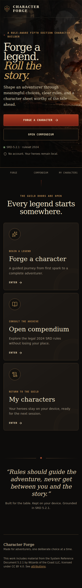
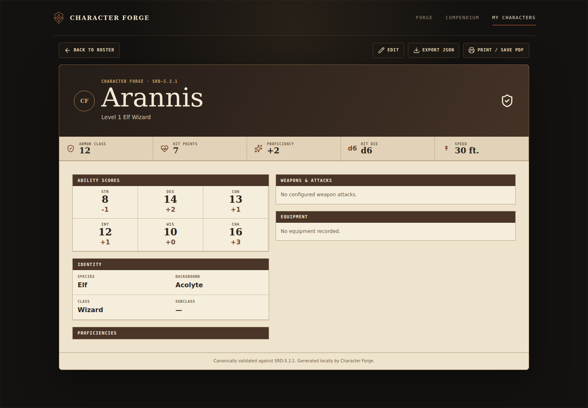

# Character Forge

Character Forge is a mobile-first, rule-aware character builder for the modern fifth-edition rules available in **SRD 5.2.1**. It aims to feel like an adventurer's workshop rather than a themed business form, while keeping the codebase straightforward and production-minded.

The roadmap phases are complete. Character Forge includes a responsive dark-fantasy landing experience, a searchable compendium, local IndexedDB character management, a versioned JSON backup format, an eight-step auto-saving builder with equipment management, canonical validation/calculation, trusted class progression through level 20, a complete 2024 subclass-name directory with honest SRD availability, Wizard spellbook ownership, spell-granting Fighting Styles, event-aware replacement validation, an original A4-ready character sheet, accessible SPA navigation, reduced-motion support, measured bundle budgets, CI, Playwright journeys, and production containers.





## Stack

- React 19, TypeScript (strict), Vite, React Router
- TanStack Query, Zod, Motion, Lucide
- ASP.NET Core on .NET 10, typed `HttpClient`, memory cache, minimal REST endpoints, OpenAPI, Problem Details
- xUnit and ASP.NET Core integration testing
- Vitest, Testing Library, and Playwright
- IndexedDB stores versioned character drafts locally; there is no server database or authentication

## Repository layout

```text
apps/
  api/          ASP.NET Core API
  web/          React application
docs/
  DECISIONS/    Architecture decision records
tests/
  CharacterForge.Api.Tests/
```

The backend uses feature folders and a small `Infrastructure` area. More projects or layers will be added only when a real dependency boundary requires them.

## Requirements

- Node.js 24 (see `.nvmrc`; Vite also supports its documented compatible Node versions)
- npm 12+
- .NET SDK 10.0.401 or a compatible newer feature band
- Chromium installed through Playwright for browser tests; Docker is optional

## Run locally

Install frontend dependencies from the repository root:

```bash
npm install
```

Start the API and web app in separate terminals:

```bash
dotnet run --project apps/api
npm run dev:web
```

Open `http://localhost:5173`. Vite proxies `/api` and `/health` to `http://localhost:5154` during development.

Optional frontend configuration can be copied from `apps/web/.env.example`. Production CORS origins are configured with `Cors__AllowedOrigins__0`, `Cors__AllowedOrigins__1`, and so on; production host filtering is configured with `AllowedHosts`. No production origin is allowed by default.

The SRD provider is configured through `SrdApi__BaseUrl`, `SrdApi__TimeoutSeconds`, and `SrdApi__CacheDurationMinutes`. Defaults target the public 2024 API with an 8-second timeout and six-hour in-memory cache. Restarting the API clears that cache.

## Quality checks

```bash
npm run lint:web
npm run test:web
npm run test:e2e
npm run build:web
npm run audit:bundle:web
dotnet build CharacterForge.slnx --configuration Release
dotnet test CharacterForge.slnx --configuration Release
```

When the API runs in Development, its OpenAPI document is available at `http://localhost:5154/openapi/v1.json`. Its health endpoint is `http://localhost:5154/health`.

## Data and licensing

The selected rules contract is `ruleset: "2024"` and `rulesVersion: "SRD-5.2.1"`. Future catalog data will be normalized by the backend from the [D&D 5e SRD API 2024](https://www.dnd5eapi.co/api/2024). The frontend will not depend directly on that provider's response shape.

Only legally redistributable SRD rules material is in scope. Non-SRD subclass names may appear as discovery metadata, but their descriptions, progression, and mechanics are neither copied nor inferred, and they remain unselectable until a lawful structured rules source exists. Do not add content from non-SRD sourcebooks or scrape D&D Beyond. The catalog exposes classes, species, backgrounds, feats, spells, and equipment through `/api/catalog/{category}` and `/api/catalog/{category}/{id}`. See [ATTRIBUTIONS.md](ATTRIBUTIONS.md) and the [API research checkpoint](docs/SRD-API-RESEARCH.md).

Draft characters can be submitted to `POST /api/characters/validate` for canonical rule validation and derived ability/proficiency, combat, progression, and spellcasting values. Later spell changes can be submitted to `POST /api/characters/validate-spell-replacement` with previous/current canonical states and an explicit class-level or Long Rest trigger; Weapon Mastery exchanges use `POST /api/characters/validate-weapon-mastery-replacement` with two canonical states and a Long Rest trigger. `POST /api/characters/evaluate-feat` evaluates canonical prerequisites and typed Ability Score Improvement proposals; active Fighting Style choices apply the typed Archery and Defense effects during complete character validation. None of these endpoints persists character data, and calculations are returned only for valid 2024 / SRD 5.2.1 documents within the rules currently implemented. The local roster can export a complete versioned JSON backup and import supported files as new local characters without overwriting an existing record.

## Architecture and roadmap

- [Architecture](docs/ARCHITECTURE.md)
- [Roadmap](docs/ROADMAP.md)
- [Current progress](docs/PROGRESS.md)
- [Deployment](docs/DEPLOYMENT.md)
- [Security review](docs/SECURITY-REVIEW.md)
- [Architecture decisions](docs/DECISIONS)

## Current limitations

- Feat effects beyond Ability Score Improvement, Archery, and Defense; rolled/manual HP; and remaining narrative-only class feature choices are future work.
- All 48 subclass names from the 2024 Player's Handbook are visible in the builder, but only the 12 SRD 5.2.1 subclasses currently have selectable, canonically validated progression.
- Spell list filtering currently supports name, level, school, and class. Ritual/concentration filters require a richer local index because the upstream 2024 list contract does not expose those fields; that index remains deferred until a future catalog-indexing phase is justified.
- The API exposes no immutable content snapshot identifier in its normal resource responses; Character Forge must retain its own provider-observation metadata when caching catalog content.

## License

Project source licensing has not yet been selected. Third-party content and assets retain the licenses recorded in [ATTRIBUTIONS.md](ATTRIBUTIONS.md).
