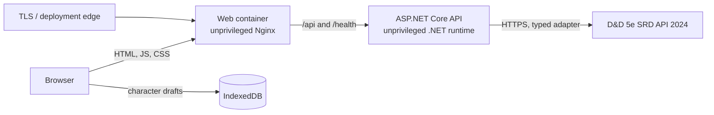

# Deployment guide

Character Forge has two stateless deployables. The browser keeps character data in IndexedDB; the API has no database or durable volume.



## Container deployment

Docker Compose is the shortest reproducible production-like setup:

```bash
docker compose build
docker compose up -d
curl --fail http://localhost:8080/health
```

Open `http://localhost:8080`. The web container serves the SPA and forwards `/api` and `/health` over the private Compose network. Both images run as unprivileged users and expose healthchecks. Stop the stack with `docker compose down`; no character data is stored in its containers.

Compose disables API HTTPS redirection because its internal hop is HTTP and the public local endpoint has no TLS. For an internet deployment, terminate TLS at the platform edge, redirect HTTP there, and keep the API private. The API default remains secure: HTTPS redirection is enabled in Production unless `HttpsRedirection__Enabled=false` is explicitly set.

## Split deployment

The web and API can be deployed separately. Build the browser with the public API origin:

```bash
docker build \
  --file apps/web/Dockerfile \
  --build-arg VITE_API_URL=https://api.example.com \
  --tag character-forge-web .

docker build \
  --file apps/api/Dockerfile \
  --tag character-forge-api .
```

When origins differ, configure the exact web origin on the API:

```text
Cors__AllowedOrigins__0=https://app.example.com
AllowedHosts=api.example.com
```

Do not use wildcard production origins. If a reverse proxy supplies forwarded headers, trust only the proxy networks controlled by the deployment platform. The process-local IP rate limit is not a substitute for an edge rate limit.

## API configuration

| Variable                       | Default                             | Purpose                                        |
| ------------------------------ | ----------------------------------- | ---------------------------------------------- |
| `SrdApi__BaseUrl`              | `https://www.dnd5eapi.co/api/2024/` | Structured SRD provider root                   |
| `SrdApi__TimeoutSeconds`       | `8`                                 | Provider request timeout                       |
| `SrdApi__CacheDurationMinutes` | `360`                               | In-memory normalized-content lifetime          |
| `Cors__AllowedOrigins__0`      | unset                               | First exact cross-origin web origin            |
| `AllowedHosts`                 | `*` in repository configuration     | Host filtering; restrict in public deployments |
| `HttpsRedirection__Enabled`    | `true`                              | API-level HTTP-to-HTTPS redirect in Production |

The service requires outbound HTTPS access to the configured provider. Restarting the API clears its memory cache. `/health` proves process readiness but deliberately does not make the external provider a health dependency.

## Release verification

Before deploying a commit, run the same gates as CI:

```bash
npm ci
npm run format:check
npm run lint:web
npm run test:web
npm run audit:bundle:web
npx playwright install --with-deps chromium
npm run test:e2e

dotnet restore CharacterForge.slnx
dotnet format CharacterForge.slnx --verify-no-changes --no-restore
dotnet build CharacterForge.slnx --configuration Release --no-restore
dotnet test CharacterForge.slnx --configuration Release --no-build
dotnet list CharacterForge.slnx package --vulnerable --include-transitive
```

After deployment, verify `/health`, `/api/meta`, one catalog list/detail, local draft creation/reopen, and canonical sheet rendering. No migration or server-data backup step exists because the server persists nothing.
